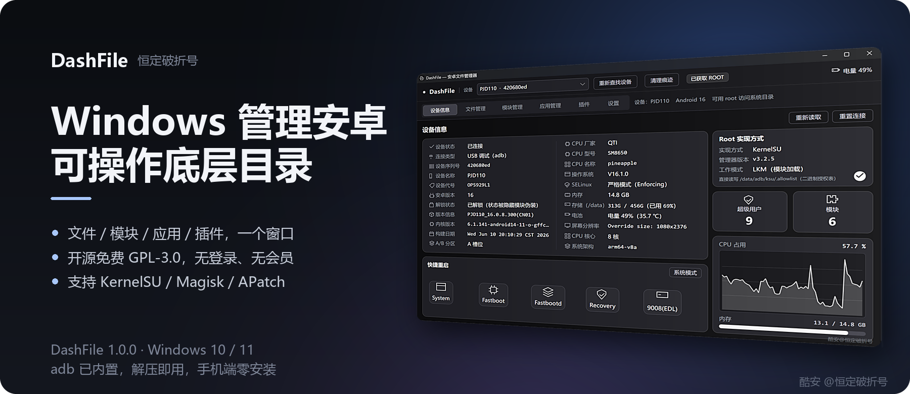
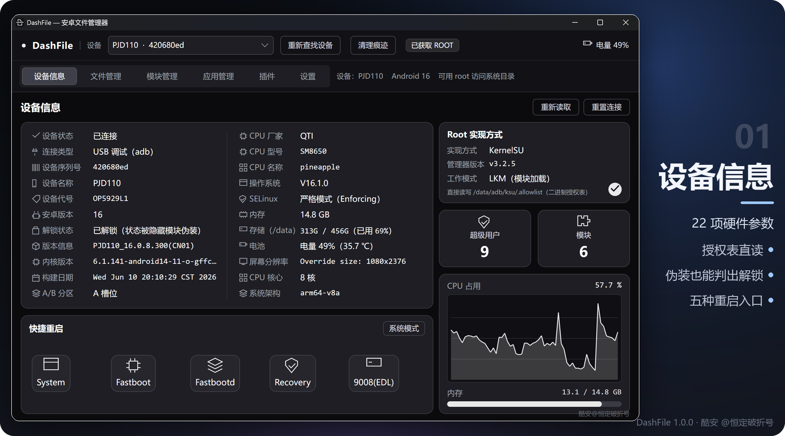
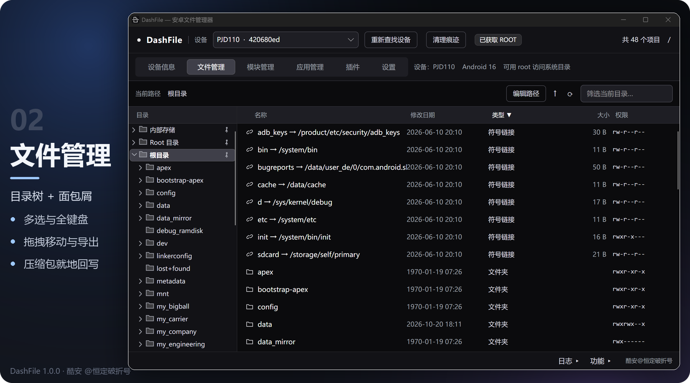
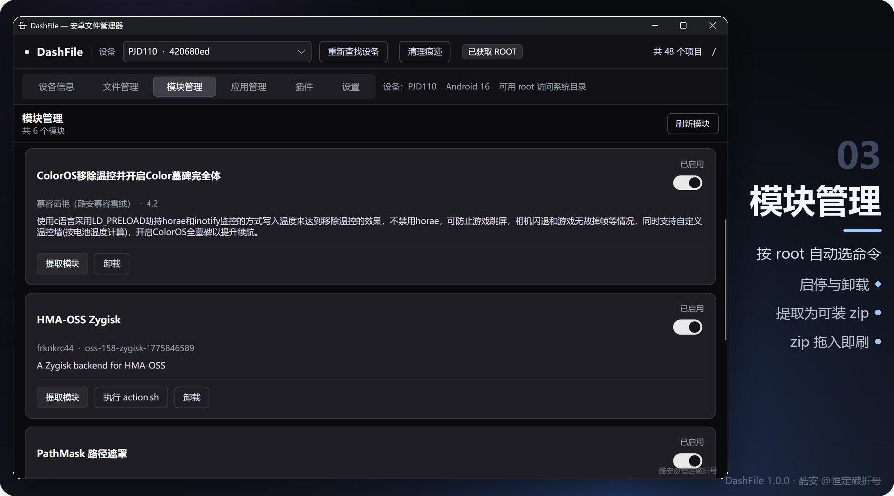
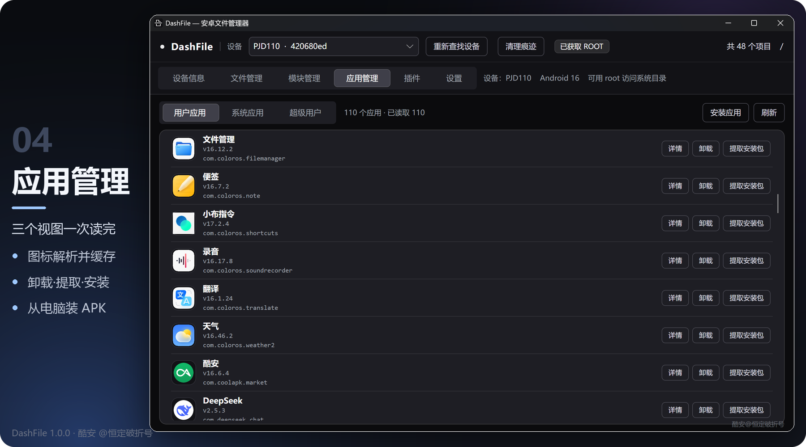
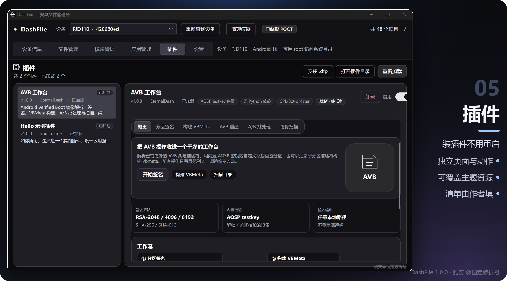
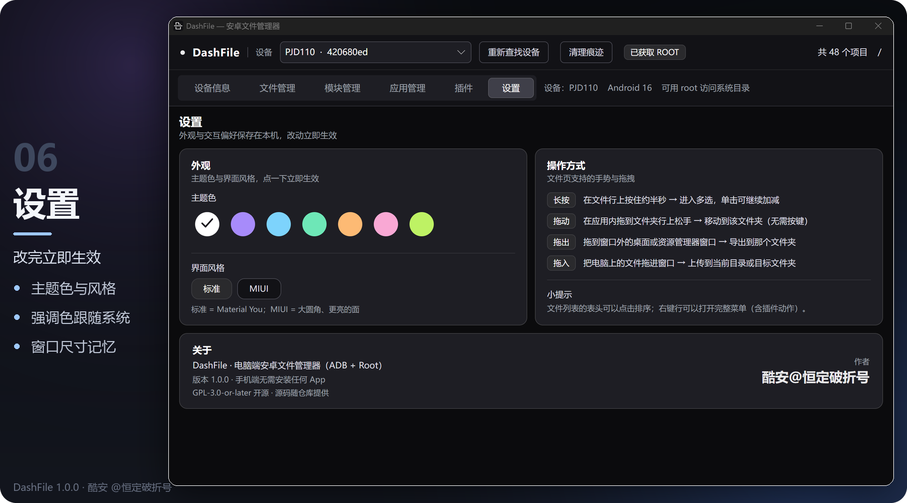

<h1 align="center">DashFile</h1>

<p align="center"><sub>Windows 桌面端 · 安卓设备管理工具</sub></p>

<p align="center">
  <a href="#构建"></a>
  <a href="#构建"></a>
  <a href="#技术栈"></a>
  <a href="LICENSE"></a>
  <a href="https://github.com/Eternal-Dash/Dashfile_Manager/releases"></a>
</p>

<br/>

<p align="center">
  在电脑上管理安卓手机。<br/>
  手机端不装任何 App，全部操作走 ADB + root。
</p>

<p align="center">
  <sub>官方发布只有 <a href="https://github.com/Eternal-Dash/Dashfile_Manager/releases">GitHub Releases</a> 一处 ·
  其它站点的安装包未经核对，请勿使用</sub>
</p>

<p align="center">
  
</p>

<br/>

**开箱即用** —— adb 已内置，免安装、不写注册表、不联网<br/>
**一个窗口** —— 文件 / 模块 / 应用 / 插件 / 设置<br/>
**插件热插拔** —— `.dfp` 拖进去就能用，禁用即卸载

---

## 目录

[设备信息](#设备信息) ·
[文件管理](#文件管理) ·
[模块管理](#模块管理) ·
[应用管理](#应用管理) ·
[插件系统](#插件系统) ·
[打开方式](#打开方式) ·
[设置](#设置) ·
[快速开始](#快速开始) ·
[构建](#构建) ·
[许可](#许可)

---

## 设备信息

> 连上就能看清这台机器，以及 root 是怎么进来的。

- **22 项参数** — 型号、代号、系统版本、内核、A/B 槽位、SELinux、分辨率
- **Root 实现识别** — KernelSU 系、Magisk 系、APatch、SuperSU、phh、Lineage 内置 su
- **授权表直读** — 不依赖管理器 App 是否安装
- **解锁状态** — 不轻信属性，防隐藏模块伪装
- **实时曲线** — CPU 占用与内存，1 秒采样
- **5 种重启** — 系统 / Fastboot / Fastbootd / Recovery / 9008

<p align="center">
  
  <br/><sub>设备信息页：左参数、右 root 实现与资源曲线</sub>
</p>

<details>
<summary>实现细节</summary>

<br/>

- **授权表**：KernelSU 系读 `/data/adb/ksu/.allowlist`；Magisk 通过 `magisk --sqlite` 读写 `magisk.db`；APatch 由 `apd` 托管，只提示不支持直改
- **解锁判定**：`ro.boot.flash.locked` / `verifiedbootstate` 会被 Shamiko 一类模块伪装成"锁定"，因此再比 `vendor.boot.*` 与 `/proc/cmdline`，并用"root 是否真的可用"反证
- **采样**：监控命令 1 秒一次，不写入运行日志

</details>

---

## 文件管理

> 资源管理器的手感，只是目标在手机上。

- **浏览** — 目录树、面包屑、排序与当前目录筛选
- **全键盘** — 方向键 / Home / End / PageUp / PageDown / Enter
- **移动与导出** — 行内拖拽移动；拖出窗口即导出，走系统原生进度框
- **压缩包** — 就地展开浏览，改完回写，不用先解压到本地
- **权限与 SELinux** — 八进制输入或逐位勾选
- **执行命令** — 双击脚本不直接执行，先开确认页

<p align="center">
  
  <br/><sub>目录树 + 面包屑 + 类型 / 权限一览</sub>
</p>

<details>
<summary>实现细节</summary>

<br/>

- 目录内容走 `ls -1p` 一次拉全量，再按差异做增量 patch
- `/sdcard` 是 FUSE 挂载，`find -type d` 会静默返回空，所以不用 find
- 滚动偏移对齐整像素、16ms 节拍，避免文字发虚

</details>

---

## 模块管理

> 刷模块不用回手机上点。

- **列表与开关** — 版本、作者、启用状态
- **提取** — 把已装模块打包成可安装 zip
- **刷入** — zip 直接拖进模块页
- **按 root 实现选命令** — `ksud` / `magisk --install-module` / `apd`
- **没有管理器 App 也能刷** — 自动退回通用部署

<p align="center">
  
  <br/><sub>模块列表：开箱即用，自带 action.sh 的会多一个入口</sub>
</p>

---

## 应用管理

> 一百多个应用，一次读完。

- **三视图** — 用户 / 系统 / 超级用户
- **图标与中文名** — 直接解析 APK 里的资源，混淆过的路径也能认
- **图标缓存** — 读过就留，刷新不重读；取不到的包短期不再重试
- **操作** — 详情、卸载 / 停用、提取 APK、从电脑安装

<p align="center">
  
  <br/><sub>应用列表：图标、版本、包名与行内操作</sub>
</p>

---

## 插件系统

> 需要更多能力时，装个插件。

- **热插拔** — `.dfp` 包，禁用或重载即卸载，不重启主程序
- **能做什么** — 页面、文件与应用右键动作、全局工具、主题资源
- **不重复造轮子** — 契约程序集与 Avalonia 强制共用宿主那份
- **卸载可控** — 可选保留或一并删除插件数据

发布包**不含任何插件**，插件在 [plugins/](plugins/) 目录按需下载：

| 插件 | 一句话 |
|:--|:--|
| **Fastboot 刷写** | 分区镜像刷写、Fastboot / ADB Root 回读、固件包预览与批量备份；先预览、双确认、全程日志，可中途停止 |
| **AVB 工作台** | AVB 解析 / 重签 / VBMeta 构建，输出与 `avbtool 1.3.0` 逐字节一致 |
| **Hello 示例插件** | 二次开发模板：一个页面 + 三个动作 |

<p align="center">
  
  <br/><sub>插件页：左列是插件，右列是它自己的页面</sub>
</p>

副行的 `v版本 · 作者 · 状态` 取自清单，作者名与版本号全部由插件作者自己填，宿主不代填、不改写。
插件的图标（`icon`）、标语（`tagline`）、能力徽标（`tags`）同样写在清单里，不写一行界面代码也能把"这是什么"说清楚。

---

## 打开方式

> 右键 18 项动作，按扩展名给默认，认不出的再让你选。

| 通用 | 安卓相关 |
|:--|:--|
| 编辑文本 | Apk 信息 |
| Xml 功能 | Apks 信息 |
| Svg 功能 | Dex 功能 |
| 十六进制 | Arsc 功能 |
| 浏览压缩包 | Class 功能 |
| Jar 功能 | 导入签名 |
| 查看图片 | 点九编辑 |
| 播放音乐 | linux 脚本 |
| 播放视频 | 查看字体 |

解析层全部自研：AXML、`resources.arsc`、DEX、APK 签名（v1 / v2 / v3）、点九图、AVB。
查看器是独立窗口，Esc 关闭。

---

## 设置

> 改完立即生效，偏好存在本机。

- **深浅外观** — 深色 · 经典 / 浅色 · 雾白微透，一键切换
- **材质** — 浅色下可开系统云母（Mica，需 Windows 11 22H2+）；不支持时自动回退实色
- **外观** — 主题色、界面风格（标准 / MIUI），强调色可跟随系统
- **窗口** — 记住上次尺寸；最大化或贴满屏幕的值不会被当成默认

浅色不是把深色反相：窗口栏约 41%、卡片约 85%、文件内容面约 93% 三级白，配合原生 Mica 底层与主题色渐变。
强调色用 HSL 保留色相与饱和度再压亮度，七种预设各自可辨；切回深色时所有画刷资源会重置，不残留浅色文字。

<p align="center">
  
  <br/><sub>设置页：左外观、右交互</sub>
</p>

---

## 快速开始

**运行环境：** Windows 10 1809+ / 11（x64）。
不需要安装 .NET 运行时、不需要单独装 adb、不需要 VC++ 运行库 —— 单文件已自带运行时（26.9 MB），adb 随包提供（`Binaries\Adb\`）。

<br/>

**1.** 手机开「开发者选项 → USB 调试」

**2.** 双击 `DashFile\DashFile.exe` —— 整个文件夹拷走即可，免安装

**3.** 手机上点「允许 USB 调试」；要读写系统目录时再允许一次 root

<br/>

> 没有 root 也能用：浏览内部存储、看应用列表、卸载应用、安装 APK 都不受影响。  
> 有 root 时默认停在根目录 `/`，只有 adb 时默认进 `/sdcard`。

详细步骤见 [docs/使用说明.txt](docs/使用说明.txt)。

---

## 构建

<details>
<summary>需要 .NET 8 SDK 与 Windows 10/11 x64，点开看命令</summary>

<br/>

```powershell
dotnet build src\DashFile.csproj -c Debug
src\bin\Debug\net8.0\DashFile.exe

powershell -ExecutionPolicy Bypass -File build\publish.ps1      # 发布包 -> DashFile\
powershell -ExecutionPolicy Bypass -File build\build-plugins.ps1 # 插件   -> build\plugin-dist\
dotnet run --project tests\DashFileTests                        # 行为测试，无需设备
```

产物：单文件 `DashFile.exe` 约 27 MB，整包约 38 MB，冷启动约 0.6 秒。

</details>

---

## 技术栈

| 层 | 用了什么 |
|:--|:--|
| 界面 | Avalonia 11.3 + FluentTheme，自绘标签条 / 平滑滚动 / 迷你图表 |
| 运行时 | .NET 8，单文件 + 压缩 + 裁剪（`TrimMode=partial`） |
| 设备访问 | ADB（内置 `Binaries\Adb`），所有 shell 参数统一转义 |
| 解析 | 自研 AXML / arsc / DEX / APK 签名 / AVB |
| 插件 | 契约程序集 + 可回收 ALC + `.dfp` 打包 |

<details>
<summary>源码结构</summary>

<br/>

```
src/                主程序
  DashFile.PluginApi/   插件契约与共享 UI 控件
  Views/ ViewModels/ Models/ Controls/ Services/ Assets/
samples/            插件源码
tests/              行为测试
build/              发版与插件构建脚本
plugins/            插件下载区（.dfp）
tools/              adb / fastboot（二进制不入库）
docs/               文档与截图
```

</details>

---

## 文档

| 文档 | 内容 |
|:--|:--|
| [架构与实现](docs/架构与实现.md) | 架构、数据流、踩坑清单 |
| [开发规范](docs/开发规范.md) | 改动流程、XAML 铁律、性能红线 |
| [插件开发指南](docs/插件开发指南.md) | 插件 API、清单、示例 |
| [变更记录](docs/变更记录.md) | 按日期记录的改动 |
| [使用说明](docs/使用说明.txt) | 面向使用者 |
| [内测说明](docs/内测说明.txt) | 重点验证项与回报格式 |

---

## 须知

- 涉及系统分区与模块的操作需要 root
- 刷模块、改分区、重签 AVB 都属于有风险操作，先备份、确认能救砖
- 内置 AOSP testkey 只适用于已解锁 bootloader 或已关闭 dm-verity 的设备
- 不联网、不收集数据；浏览严格只读，退出时清理临时文件

---

## 许可

以 **GPL-3.0-or-later** 发布，全文见 [LICENSE](LICENSE)，第三方声明见 [THIRD-PARTY-NOTICES.md](THIRD-PARTY-NOTICES.md)。

- 可自由使用、修改、再分发；分发二进制时需继续使用 GPLv3 并提供对应源码
- 二次修改、再分发请保留原作者署名：**恒定破折号（EternalDash）**
- 第三方插件与宿主组合分发时应使用 GPLv3 兼容许可

---

## 关于 AI 辅助

部分代码与文档在 **DeepSeek** 模型辅助下完成，主要用于方案对照、代码复核与文档初稿。
所有改动都经过人工审阅、编译、行为测试与真机验证后才进入仓库；设计与取舍由作者负责。

---

<p align="center">
  <b>恒定破折号（EternalDash）</b><br/>
  <sub>酷安 @恒定破折号</sub>
</p>

<p align="center">
  <sub>
    <a href="https://github.com/Eternal-Dash/Dashfile_Manager/issues/new/choose">报告问题 / 提建议</a> ·
    <a href="https://github.com/Eternal-Dash/Dashfile_Manager/discussions">使用提问 / 插件分享</a><br/>
    提问题时请附：页面 · 操作步骤 · 期望与实际 · 截图 · Log 目录下的日志
  </sub>
</p>
